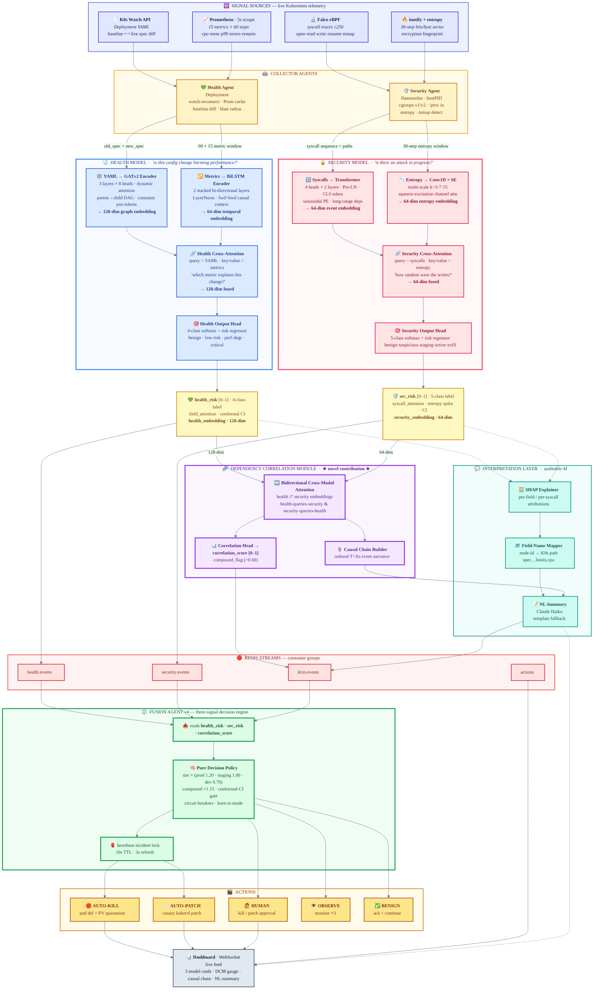

# KubeHeal

RVCE · Unisys "Agents Unleashed" · UIP · Mentor: Dr. Mohana
Team: Ryan Dave Fernandes · P Koti Darshan · Rakshak S

KubeHeal is an experimental Kubernetes control plane for detecting configuration drift and suspicious container activity. Its pipeline is Sense, Score, Decide, Act, and Record. The implementation is under active development; this repository does not establish production readiness.

## Current status

- Health Agent watches labeled Deployments, compares their specs with a first-seen Redis baseline, and requests Prometheus metric windows before scoring drift.
- Security Agent consumes Falco events and samples process write activity and entropy. Falco replay is available for controlled tests; fixtures are hand-written examples, not captured attacks.
- Health and Security scoring use the shipped LightGBM bundles, split-conformal prediction sets, and TreeSHAP factors. Fusion uses deterministic correlation because LightGBM does not expose the embeddings required by the old DCM. Automatic actions require exactly one conformal label and the policy's other safety gates. See [SPEC_VS_CODE](docs/kubeheal/SPEC_VS_CODE.md) for item-level status and evidence.
- The bundles' shipped security validation figures are based on synthetic classes and are not evidence of live model quality. Health live scores have not been validated on representative live metric windows. P12 retraining remains unapproved and was not run.
- **Verified on k3d:** on 2026-11-12, a scripted ransomware alert traversed Fusion, Executor intake, freeze, snapshots, quarantine, scale-to-zero, restore, entropy rescan, quarantine release, and ledger recording on a scratch Deployment in `staging`. The final enforce window lasted 45 seconds; its entropy scan read 5 clean files and found 0 high-entropy files. The alert was scripted using model fields from the D-5 replay. Falco was not installed, so this does not verify live detection or Sense. This is k3d evidence, not real-node validation. See the [F3 run evidence](docs/kubeheal/demo-evidence/F3/RUNBOOK_F3.md).
- The D-5 hand-written replay also ran on k3d: the Security Agent produced a model-scored ransomware event and Fusion recorded a dry-run action. It is replay evidence, not a live Falco capture or Executor containment. See [the replay output](docs/kubeheal/demo-evidence/F3/10_d5_rerun.txt) and [ledger](docs/kubeheal/demo-evidence/F3/11_d5_rerun_ledger.jsonl).
- **Final live acceptance, 2026-11-13:** F2 replay, F3 scripted-alert containment/restore, F4 HMAC, F5 scripted dev/prod baseline promotion, F6 signed invalid-request refusals, F7 M2/D1/fresh-Security gates, F8 dashboard walkthrough, F9 authenticated mode toggle, and F10 scripted canary heal plus bad-p99 rollback have live k3d evidence. Enforce actions were limited to logged scripted windows with dead-man protection; mode returned to `test`. See [the rehearsal matrix](docs/kubeheal/DEMO_RUNBOOK.md) and per-feature evidence.
- **Verified on k3d:** F11's warmed 32-VU/90-second run passed 113,873/113,873 checks with zero refusals, median 24.03 ms, p95 37.9 ms, and HPA 2 -> 8 -> 2; a Grafana screenshot is saved. P11 E1 separately passed 112,327/112,327 checks with zero refusals, p50 24.34 ms and p95 38.19 ms; E2 recovery measured 1.25 seconds. The five-request warm-up is disclosed in both results; F11's aggregate count includes those calls. These are individual k3d runs, not performance guarantees.
- U6 passed twice on a separate fresh `kubeheal-rehearsal` cluster using vendored charts and a populated local image cache. The original `k3d-kubeheal` cluster and Redis, MinIO, and prod victim PVCs were preserved. F3 uses scripted Sense input because Falco is absent; this does not verify live detection or real-node behavior.
- **Not measured:** F8 SnapshotFreeze release (no held target); F9 same-input test/enforce applied-action comparison; P11 E3-E6 and V5-E1 (scenario/safety limitations documented in [P11 coverage](docs/kubeheal/results/p11/P11_COVERAGE.md)). Shipped security validation figures use synthetic classes and do not establish live model quality. P12 retraining remains unapproved and was not run.

The demo environment targets a local k3d cluster. Read `demo/README.md`, [the demo runbook](docs/kubeheal/DEMO_RUNBOOK.md), and `docs/dev-notes/NEXT_FOR_CODEX.md` before using it. The global source of truth is the `kubeheal-mode` ConfigMap, key `mode`; it defaults to `test`. In test mode, sensing, scoring, decisions, and ledger recording continue while remediation Kubernetes writes are blocked and recorded as "would have" actions. The Remediation Executor validates each request and is the only agent with remediation Kubernetes write permissions; it records intent before a corrective write and checks the kill switch before every write. The Security Agent separately verifies kill-switch mode before a node-local cgroup freeze. Containment runs in this order: freeze, forensic snapshot, quarantine, scale to zero, restore from the pre-T0 snapshot, entropy rescan, lift quarantine, and record the result. Freeze requests and results use HMAC-SHA256 with `CONTAIN_HMAC_KEY` from the chart-managed `kubeheal-containment-hmac` Secret, key `key`. Redis authentication uses a separate Secret, so a Redis credential alone cannot sign containment messages; an operator who can read the HMAC Secret can. The dashboard has a narrow permission to update the kill-switch ConfigMap with its admin token. A successful component or unit test does not by itself verify a full end-to-end workflow. Current findings are recorded in [PROGRESS](docs/dev-notes/PROGRESS.md).
- Training scripts are present, but no training should be inferred from their presence. Do not run training as part of setup.

## Local development

Use Python 3.11 and install the dependencies from `requirements.txt`. Some entries are pinned to an exact version (for example `torch==2.2.0`) and some are lower bounds or ranges (for example `torch-geometric>=2.5.0` and `numpy<2`), so installs are not fully reproducible. Then run the tests:

```powershell
$env:PYTHONPATH='.'
.venv\Scripts\python.exe -m pytest tests/ -q
```

Model servers require compatible checkpoint files and their preprocessing sidecars. They fail closed when required checkpoints are missing or incompatible, except when `ALLOW_RANDOM_WEIGHTS=true` is set explicitly (see `services/ckpt.py`): the server then serves random weights and its `/health` response reports `random_weights=true`. Check each server's `/health` response before relying on scores. Random weights are for development and unit tests only and are not suitable for operation.

## Kubernetes demo

The demo scripts and k3d configuration are under `demo/`. Read `demo/README.md` and `docs/dev-notes/NEXT_FOR_CODEX.md` before using them. The global kill switch defaults to `test`, which permits sensing, scoring, decisions, and audit recording but prevents Kubernetes remediation writes.

## Training and promotion gates (not approved: do not run without the owner's approval)

Training is not approved for this project. Do not run any command in this section unless the owner has explicitly asked for it. Training is slow and GPU-bound, and real ransomware traces need a live Falco cluster; the security generator synthesises samples for offline training. The health model trains on the real drift CSV in the repository (`models/health_model/dit-merged-complete.csv`). The commands are listed for reference only.

```bash
# 0. (Windows GPU) install CUDA torch first:
#    pip install torch==2.2.0 --index-url https://download.pytorch.org/whl/cu121
#    pip install torch-geometric torch-scatter torch-sparse -f https://data.pyg.org/whl/torch-2.2.0+cu121.html

# 1. Health Model, real data
PYTHONPATH=. python -u models/train_health_model.py \
    --epochs 30 --batch-size 16 --patience 6

# 2. Security training data (synthetic)
PYTHONPATH=. python models/generate_security_training_data.py \
    --output data/security_training.jsonl

# 3. Security Model
PYTHONPATH=. python -u models/train_security_model.py \
    --data data/security_training.jsonl --epochs 25 --batch-size 32 --patience 5

# 4. DCM, staged, AFTER 1 and 3 (freezes both base models)
PYTHONPATH=. python -u models/train_dcm.py --epochs 25 --batch-size 32

# 5. (optional) recalibrate conformal intervals on a held-out set
PYTHONPATH=. python models/calibrate_conformal.py --coverage 0.90

# 6. check the promotion gates
PYTHONPATH=. python models/validate_all_models.py

# 7. export for serving
PYTHONPATH=. python models/export_security_model.py --quantize fp16
PYTHONPATH=. python models/export_dcm.py --quantize fp16
PYTHONPATH=. python models/export_health_model.py

# 8. (optional) push to the MinIO model registry
PYTHONPATH=. python models/upload_to_registry.py --version v4.0.0
```

Outputs land in `models/<model>/checkpoints/` as `best_*.pt`, `*_conformal.json` and `*_report.json`, and the servers load the checkpoints on startup.

Promotion gates are defined in `models/validate_all_models.py`: an F1 gate for the Health and Security models, an AUROC gate for the DCM, and an advisory (non-blocking) latency check. The thresholds are in that script; this README does not restate them. Missing checkpoints are reported as SKIP, not as failures, so a SKIP is not evidence that a model passed.

## Documentation

- [Architecture](docs/kubeheal/ARCHITECTURE.md) describes the implemented flow and labels planned pieces.
- [Specification status](docs/kubeheal/SPEC_VS_CODE.md) maps the project specification IDs to code and evidence.
- [Implementation progress](docs/dev-notes/PROGRESS.md) records checked work, observed results, and deferred items.
- [Project specification](docs/kubeheal/PROJECT_SPEC.md) is the target design, not a claim that every item is implemented.
- [Architecture flow walkthrough](docs/architecture-flow.md) is a layer-by-layer description; the diagram is rendered in [architecture-flow.png](docs/architecture-flow.png).



To re-render the diagram from `docs/architecture-flow.mmd`:

```bash
npx -y @mermaid-js/mermaid-cli -i docs/architecture-flow.mmd -o docs/architecture-flow.png -s 2 -b transparent
```

## License

RVCE · Unisys UIP · Confidential
