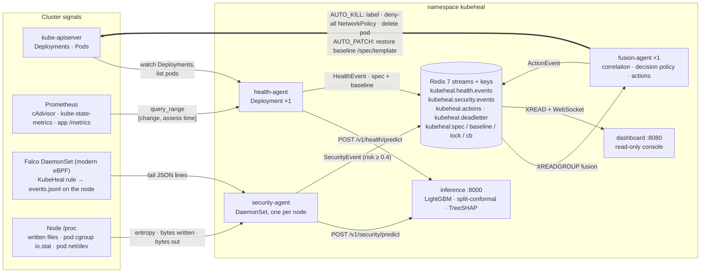

# KubeHeal

**Autonomous configuration-drift and ransomware remediation for Kubernetes.**

KubeHeal watches every real Deployment spec change and every pod's file activity, scores them with two
small LightGBM models (with conformal uncertainty and exact TreeSHAP explanations), correlates the two
signals per workload, and a single fusion agent acts: it quarantines and deletes a pod that behaves
like ransomware, rolls a drifted Deployment back to its last known-good template, or hands the case
to a person. Every decision is published to a live dashboard with a plain-English rationale.



## Capabilities

| | What it does |
|---|---|
| **Config-drift detection** | The health agent assesses a Deployment 60 s after a real spec change (at once on a posture violation, within about 2 s of a failed rollout appearing): 24 spec-diff features plus 12 features of the post-change Prometheus window (CPU/memory utilisation, throttling, p99 latency, 5xx ratio, restarts, ready ratio). |
| **Rule-based rollback** | Hard rollout failures after a change trigger AUTO_PATCH by rule, at any tier and any model confidence. These are pods created after the change stuck in `ImagePullBackOff`, `ErrImagePull`, `InvalidImageName`, `CrashLoopBackOff`, `CreateContainer*Error`, `RunContainerError` or `OOMKilled`, and `ProgressDeadlineExceeded` on the rollout. The model handles subtle drift: throttling, latency, memory pressure. |
| **Ransomware-like behaviour** | The security agent tails Falco file syscalls on data volumes, samples the entropy of files the pod wrote, measures the pod's write and network-out bytes, and scores a per-pod 60 s window every 1 s, or at once at 32 new events. |
| **Correlation** | A deterministic score joins a health and a security event of the same workload within 120 s. A compound incident raises both scores by ×1.15. |
| **Explanations** | Every event carries class probabilities, the conformal prediction set and the top 5 TreeSHAP factors. Every action carries a rationale and a summary. |
| **Remediation** | AUTO_KILL: label the pod `kubeheal.io/quarantined`, create a deny-all NetworkPolicy owned by the pod, delete it. AUTO_PATCH: JSON-patch `/spec/template` (and `/spec/replicas` if it changed) back to the stored baseline. |

### Safety rails

These are always on:

- **One actor.** Only the fusion agent can change the cluster. Its RBAC covers pods (get, patch, delete), Deployments (get, patch), NetworkPolicies (create) and nothing else.
- **Observe by default.** In code, `KUBEHEAL_MODE` defaults to `observe` (decide and publish `would_*`, change nothing). The shipped manifest sets `enforce`.
- **Protected scope.** KubeHeal never acts in `kube-system`, `kube-public`, `kube-node-lease`, `kubeheal`, any namespace in `EXTRA_PROTECTED_NAMESPACES`, or on objects labelled `kubeheal.io/protected=true`.
- **Confidence gates.** A model-driven AUTO_* decision needs an adjusted score of at least 0.85 and a single-label conformal set. Dev-tier namespaces (×0.7) can never reach that score, so only the rollback rule acts there.
- **Blast radius.** Quarantine is per pod and is garbage-collected with the pod. A per-workload incident lock prevents overlapping actions, and per-workload hourly circuit breakers apply (3 kills, 5 patches).
- **No invented data.** No action is taken without a real event, a pod or a stored baseline. A missing pod or baseline escalates to HUMAN.

## Quickstart (minikube)

You need `uv`, `kubectl`, `helm` and `minikube` (or `docker` plus any cluster). The lab runs were
measured on an 8 CPU / 8 GB minikube.

```bash
minikube start --cpus=8 --memory=8g
uv sync --all-extras                 # Python 3.13 env from pyproject.toml + uv.lock
uv run --all-extras pytest && uv run --all-extras ruff check . # tests + lint

./deploy/scripts/install.sh   # builds 4 images, installs Prometheus + Falco (Helm), kubectl apply -k deploy/k8s/, demo app
./deploy/scripts/demo.sh      # A) CPU-limit drift → health → decision   B) detection-test workload → AUTO_KILL
./deploy/scripts/reset.sh     # back to a clean demo baseline (streams, keys, circuit breakers, victim app)
```

To open the dashboard, run `kubectl -n kubeheal port-forward svc/kubeheal-dashboard 8080:8080` and go
to <http://localhost:8080>. `demo.sh` starts this port-forward for you.

The fusion agent ships in **enforce** mode, so the demo really patches and kills inside the `demo`
namespace. Install, demo, dashboard, lab collection and troubleshooting are covered in
[docs/operations.md](docs/operations.md).

## Repository layout

| Path | What |
|---|---|
| `kubeheal/contracts.py` | The single source of truth: stream names, Redis keys, labels, event models |
| `kubeheal/features/` | Feature code shared by training and the live agents (train/serve parity) |
| `kubeheal/ml/` | `ModelBundle`: LightGBM + split-conformal + TreeSHAP |
| `kubeheal/correlation.py` | Deterministic compound-incident score |
| `kubeheal/inference/app.py` | FastAPI inference service (:8000) |
| `agents/{health,security,fusion}_agent/`, `agents/common.py` | The agents. Fusion owns every cluster mutation |
| `dashboard/` | Read-only FastAPI + JS console (:8080) |
| `training/` | `train.py`, dataset adapters, synthetic security generator, lab collectors (`collect/`) |
| `models/{health,security}/` | Trained bundles (`model.txt` + `meta.json`) baked into the inference image |
| `deploy/k8s/` | Kustomize: `base/` manifests + RBAC (default dev install), `overlays/production` (no dashboard, inference HPA/PDB, PriorityClass); Falco rule, Helm values for Prometheus and Falco |
| `deploy/docker/` | 4 images: `inference`, `agents` (all three agents), `dashboard`, `chaos` |
| `deploy/scripts/` | `install.sh`, `demo.sh`, `reset.sh`, `seed_demo.sh` |
| `deploy/chaos/`, `deploy/demo/` | Non-destructive detection-test workload; demo app (podinfo + load generator) |
| `tests/` | pytest suite, including the train/serve contract tests |

## Configuration

These are the main settings. The full per-component table is in
[docs/architecture.md](docs/architecture.md#runtime-configuration).

| Env var | Default | Effect |
|---|---|---|
| `KUBEHEAL_MODE` | `observe` (manifest: `enforce`) | `observe` publishes `would_*` decisions and changes nothing |
| `MAX_KILLS_PER_HOUR` / `MAX_PATCHES_PER_HOUR` | `3` / `5` | Per-workload circuit breakers |
| `EXTRA_PROTECTED_NAMESPACES` | empty | Namespaces added to the built-in protected set |
| `WATCH_NAMESPACES` | empty (all) | Limits the health and security agents to these namespaces |
| `ASSESS_DELAY_S` | `60` | Length of the post-change metric window before a health assessment (sooner on a posture violation or failed rollout) |
| `KUBEHEAL_CAPTURE` | `0` | `1` makes the security agent record every scored window (lab collection only) |

The namespace label `kubeheal.io/namespace-tier: prod|staging|dev` sets the tier multiplier. Without
the label, the tier is guessed from the namespace name.

## Results

<!-- RESULTS: fill after retraining -->

| | Health | Security |
|---|---|---|
| Training data (rows / groups) | <!-- RESULTS --> | <!-- RESULTS --> |
| Grouped-CV macro-F1 | <!-- RESULTS --> | <!-- RESULTS --> |
| Held-out test macro-F1 | <!-- RESULTS --> | <!-- RESULTS --> |
| Held-out-family macro-F1 (pooled) | <!-- RESULTS --> | <!-- RESULTS --> |
| Conformal coverage / mean set size (α = 0.1) | <!-- RESULTS --> | <!-- RESULTS --> |
| Inference latency p50 / p99 (incl. TreeSHAP) | <!-- RESULTS --> | <!-- RESULTS --> |

| End-to-end (demo, minikube) | Time |
|---|---|
| Detection-test workload start → pod killed | <!-- RESULTS --> |
| Spec change → AUTO_PATCH (rule path) | <!-- RESULTS --> |
| Spec change → AUTO_PATCH (model path) | <!-- RESULTS --> |

Tier 1 capture (no `read`/`write` hooks) cut Falco to 53m CPU p50 (was 1985m) and 209 Mi memory p50 (was 565 Mi) under a 300 s heavy-I/O load; kill-time numbers follow the security retrain on lab data. Details in [docs/architecture.md](docs/architecture.md#resources).

How the models are trained and evaluated is described in
[docs/models-and-data.md](docs/models-and-data.md).

## Limitations

- **Exfiltration is unvalidated.** The `exfiltration` class (and `suspicious`) is trained only on synthetic windows. The serve-time byte counters are real, but no real exfiltration was ever observed.
- **One workload and one node.** Health lab data comes from one workload type (podinfo) on a single-node minikube. Effects on a multi-node cluster under real traffic can differ.
- **Simulated ransomware.** Ransomware windows come from one parameterised, non-destructive simulator, not from real malware families.
- **60 s window.** Health is judged on the first 60 s after a change. Harm that appears later (slow leaks) is missed.
- **Pre-existing drift.** The first spec the health agent sees is assumed good and becomes the baseline, so drift that predates the agent is not detected.
- **Redis is a single point of failure.** It runs without persistence. On a restart the streams and baselines are lost, and baselines are re-learned on first sight.

## License

RVCE · Unisys UIP. Built for Unisys "Agents Unleashed".

Team: Ryan Dave Fernandes · P Koti Darshan · Rakshak S. Mentor: Dr. Mohana.
