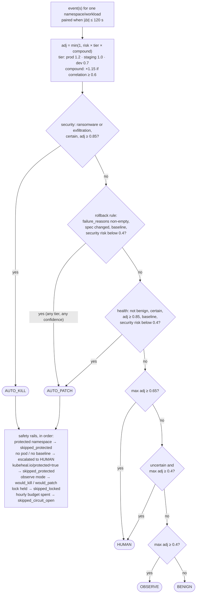
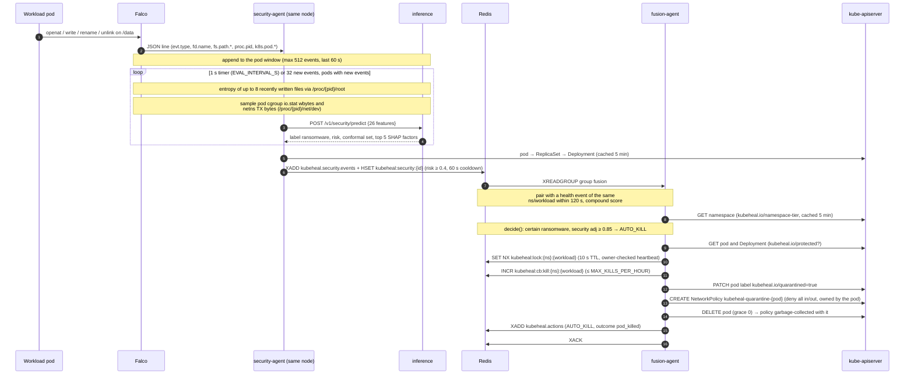
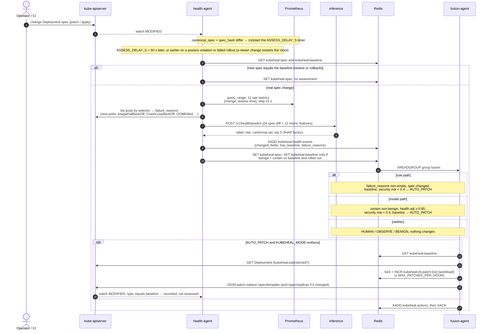

# KubeHeal architecture

This document covers what each component does, the contracts between components, how detections
become decisions and actions, the runtime configuration, and how failures are handled. The system
diagram is at the top of the [README](../README.md). Models and data are covered in
[models-and-data.md](models-and-data.md), and running the system in [operations.md](operations.md).

## Components

| Component | Kind (namespace `kubeheal`) | Entry point | Responsibility |
|---|---|---|---|
| **inference** | Deployment ×1 (dev) / 2–6 with an HPA (production), `kubeheal/inference:v5` | `uvicorn kubeheal.inference.app:app` (:8000) | Loads `models/{health,security}` at startup and serves `POST /v1/{task}/predict`. Never serves untrained weights: a missing bundle makes that task, and `/readyz`, return 503. |
| **health-agent** | Deployment ×1, `kubeheal/agents:v5` | `python -m agents.health_agent.agent` (:8080) | Watches Deployments and assesses each real spec change `ASSESS_DELAY_S` (60 s) after it is seen, sooner on a posture violation or failed rollout. Derives `failure_reasons`, publishes a `HealthEvent`, and keeps the spec and baseline keys up to date. |
| **security-agent** | DaemonSet, `hostPID`, `kubeheal/agents:v5` | `python -m agents.security_agent.agent` (:8080) | Tails Falco JSON on its node and builds per-pod windows. Adds file entropy, write bytes and network-out bytes, scores a pod every 1 s or as soon as it has 32 new events, and publishes a `SecurityEvent` when risk ≥ 0.4. **It observes only.** |
| **fusion-agent** | Deployment ×1, `strategy: Recreate` | `python -m agents.fusion_agent.agent` (:8080) | The single decision point and the only component that changes the cluster. It pairs events, scores correlation, runs the pure policy, acts or records `would_*`, and publishes an `ActionEvent` for every decision. |
| **dashboard** | Deployment ×1 | `uvicorn dashboard.fastapi_app:app` (:8080) | Read-only console that tails the three streams and pushes them over WebSocket. It has no Kubernetes access. |
| **redis** | Deployment ×1, `redis:7.4.2-alpine` | `redis-master:6379` | Holds the streams and keys. It is ephemeral (no RDB or AOF), capped at 256 MB with `noeviction`, and a NetworkPolicy allows only same-namespace clients. |
| Prometheus | Helm `kube-prometheus-stack` 92.10.1, namespace `monitoring` | `prometheus-operated:9090` | cAdvisor, kube-state-metrics and app `/metrics` (PodMonitor `kubeheal.io/scrape=true`), every 15 s, with keep-lists. |
| Falco | Helm `falco` 9.2.0, namespace `falco` | `/var/run/falco/events.jsonl` (hostPath) | Modern eBPF, loading **only** `deploy/k8s/falco-kubeheal-rules.yaml`. It writes JSON to a node file that the security agent tails. |

Shared code lives in `kubeheal/`, which every image copies: `contracts.py`, `features/`, `ml/` and
`correlation.py`. Only the inference image and training import `lightgbm`.

## Contracts (`kubeheal/contracts.py`)

All names below are defined in `kubeheal/contracts.py` and nowhere else, so a rename is a one-file
change. Stream entries are flat `str → str` maps: nested values are compact JSON, booleans are
`"1"`/`"0"`, and `None` is `""` (`to_fields()` / `from_fields()`).

### Streams

| Stream | Producer → consumer | Payload |
|---|---|---|
| `kubeheal.health.events` | health-agent → fusion (group `fusion`), dashboard | `HealthEvent` |
| `kubeheal.security.events` | security-agent → fusion (group `fusion`), dashboard | `SecurityEvent` |
| `kubeheal.actions` | fusion → dashboard | `ActionEvent` |
| `kubeheal.deadletter` | fusion | The original fields plus `_stream`, `_id` and `_error` |
| `kubeheal.security.capture` | security-agent (only when `KUBEHEAL_CAPTURE=1`) → `training/collect/security_lab.py` | `SecurityEvent` for **every** scored window, whatever its risk |

Every XADD uses `MAXLEN ~ 10000` (`STREAM_MAXLEN`).

### Redis keys

| Key | Written by | Meaning |
|---|---|---|
| `kubeheal:spec:{ns}:{workload}` | health | Last canonical spec the agent recorded |
| `kubeheal:baseline:{ns}:{workload}` | health (read by fusion) | Restore target for AUTO_PATCH: set on first sight, then promoted only when a new spec is benign **and certain relative to the current baseline** and its rollout completed |
| `kubeheal:{health\|security\|action}:{event_id}` | every publisher | Hash copy of an event for dashboard detail lookups. TTL 24 h. |
| `kubeheal:lock:{ns}:{workload}` | fusion | Incident lock: `SET NX PX 10000`, a unique token per holder, and an owner-checked heartbeat every 3 s (Lua) |
| `kubeheal:cb:{kill\|patch}:{ns}:{workload}` | fusion | Circuit-breaker counter: `INCR` plus `EXPIRE NX 3600` in one transaction |

### Labels and annotations

| Label | Where | Meaning |
|---|---|---|
| `kubeheal.io/protected=true` | pod or Deployment | KubeHeal never acts on it |
| `kubeheal.io/quarantined=true` | pod, set by fusion | Selected by the pod's deny-all quarantine NetworkPolicy |
| `kubeheal.io/namespace-tier=prod\|staging\|dev` | namespace | Tier multiplier. Without it, the tier comes from the name (`prod` → prod, `stag` → staging, otherwise dev). |
| `kubeheal.io/scrape=true` | app pods | Scraped by the `kubeheal-apps` PodMonitor (request, error and latency metrics) |
| `kubeheal.io/metrics=true` | KubeHeal Services | Scraped by the `kubeheal` ServiceMonitor |

Built-in protected namespaces are `kube-system`, `kube-public`, `kube-node-lease` and `kubeheal`.

### Event models

| Model | Fields |
|---|---|
| `Prediction` (inference response) | `model_version`, `label`, `risk` (Σ p·class_risk), `probabilities`, `prediction_set`, `uncertain` (set ≠ one label), `top_factors[]` (`feature`, `value`, `contribution`), `latency_ms` |
| common to `HealthEvent` / `SecurityEvent` | `event_id`, `namespace`, `workload` (owning Deployment, which is the join key), `pod`, `timestamp_ms`, `model_version`, `label`, `risk`, `uncertain`, `probabilities`, `top_factors`, `features` |
| `HealthEvent` | adds `spec_changed`, `changed_fields` (dotted paths, at most 50), `has_baseline`, `failure_reasons` (rollout failures seen after the change, plus `policy:<feature>` posture violations relative to the baseline; empty if none) |
| `SecurityEvent` | adds `window_start_ms`, `window_end_ms`, `n_events` |
| `ActionEvent` | `event_id`, `namespace`, `workload`, `pod`, `decision`, `mode` (`observe`\|`enforce`), `outcome`, `score`, `compound_score`, `rationale`, `summary`, `health_event_id`, `security_event_id`, `timestamp_ms` |

Labels and class risks are listed in index order, which is also the model class order:

| Task | Labels | Class risk |
|---|---|---|
| health | `benign`, `degradation`, `critical` | 0.05, 0.60, 0.95 |
| security | `benign`, `suspicious`, `ransomware`, `exfiltration` | 0.05, 0.45, 0.95, 0.85 |

### Inference API (:8000)

- `POST /v1/health/predict` and `POST /v1/security/predict` take `{"features": {name: float|null}, "request_id"?}` and return a `Prediction`.
  - Error responses: an unknown feature returns 422, NaN or Inf returns 422, more than 200 keys returns 422, a body over 64 KiB returns 413, and a task whose bundle is not loaded returns 503.
- `POST /v1/health/predict_batch` and `POST /v1/security/predict_batch` take `{"items": [<predict body>, ...]}` (1 to 256 items) and return a list of `Prediction` in the same order. The body cap is 1 MiB (256 × 4 KiB); the per-item rules above apply.
- **Explanations are computed only where they are used.** TreeSHAP is most of the inference CPU, so security predictions with risk below `SECURITY_PUBLISH_RISK` (0.4, in `contracts.py`; the same threshold the agent publishes at) return `top_factors: []`. Every published security event is therefore explained. Health predictions are always explained. Batch cost for mostly-benign security windows: 3.91 → 0.80 ms per row.
  - Prediction runs with `num_threads=1` in the threadpool.
- `GET /healthz` always returns 200.
- `GET /readyz` returns 200 only when both bundles are loaded, together with the model versions.
- `GET /metrics` returns `kubeheal_inference_requests_total`, `_latency_seconds` and `_predictions_total`.

## Detection pipelines

### Health: configuration drift

1. **Watch.** A Deployment watch (all namespaces, or one per entry in `WATCH_NAMESPACES`) computes `canonical_spec`: a camelCase DeploymentSpec with empty values dropped. Only a changed `spec_hash` counts. Status-only updates just refresh the "rollout complete" flag.
2. **Debounce.** A per-workload timer fires `ASSESS_DELAY_S` (60 s) after the change was first seen. A newer change restarts the timer. The assessment comes sooner when the change adds a posture violation (at once) or when a failed rollout shows up (polled every `POLL_S` = 2 s). Assessments run off the watch loop, at most 8 at a time.
3. **Compare.** The first time a workload is seen, its spec is stored as both spec and baseline, assumed good. A spec equal to the stored baseline (an AUTO_PATCH restore or a manual rollback) is recorded without an assessment.
4. **Features.**
   - **Metrics:** `agents/health_agent/prometheus.fetch_window` queries the 11 raw metrics over `[change seen, assess time]` at a 15 s step, in raw SI units.
   - **Features:** `health_features(old, new, window)` returns 36 features (24 spec-diff and 12 metric). A missing metric is `None`, never 0.
   - **Failure reasons:** `failure_reasons` collects Kubernetes evidence that the new spec cannot run. The agent lists the Deployment's pods by its `selector.matchLabels` and keeps those created at or after the change (with 5 s of slack). For each one it records an init or app container waiting in `ImagePullBackOff`, `ErrImagePull`, `InvalidImageName`, `CrashLoopBackOff`, `CreateContainerConfigError`, `CreateContainerError` or `RunContainerError`, and a last termination reason of `OOMKilled`. It also adds `ProgressDeadlineExceeded` when the watched status shows `Progressing=False` for the current generation. If listing the pods fails, only the pod evidence is lost. These reasons are not model features.
   - **Policy violations:** the agent also adds one `policy:<feature>` entry for each security-posture weakening the spec introduces **relative to the baseline**: `privileged_added`, `root_user_added` (`runAsUser: 0` / `runAsNonRoot: false`), `capabilities_added`, `host_namespace_added` (hostNetwork/hostPID/hostIPC), `host_path_added`. These come from the existing spec-diff features. Because they are judged against the baseline, a violation left in place is reported again on every later change. **A spec is never promoted to baseline while `failure_reasons` is non-empty**, so a model that rates a posture weakening benign can't make it the restore target.
5. **Predict and publish.** The agent calls `/v1/health/predict`, then XADDs the `HealthEvent` and saves the spec **after** the publish succeeds.
6. **Promote the baseline.** The new spec becomes the baseline only if the model calls it benign and certain **against the current baseline** (re-predicted when the previous spec was not the baseline) **and** its rollout completed: observedGeneration is current and all desired replicas are updated and available. A bad image or a crash-looping spec therefore never becomes the restore target.

### Security: ransomware-like file activity

1. **Capture.** A single Falco rule, *KubeHeal Data File Activity*, emits file syscalls of `CAPTURED_GROUPS` (read, write, rename, unlink, truncate, chmod) on `kh_data_dirs` (default `/data`) from containers in pods. The rule hooks no `read()`/`write()`: it captures `open`, `openat`, `openat2` and `creat`, and `open_syscall` classifies each by `evt.arg.flags` into `open_w` (write intent: `O_WRONLY`, `O_RDWR`, `O_CREAT`, `O_TRUNC`, or `creat`) or `open_r`. So `frac_read` and `frac_write` are per-file opens by intent, and `frac_open` is kept as a feature but is always 0 live. A test keeps the rule's `evt.type` list and `CAPTURED_GROUPS` in sync.
2. **Tail.** `FalcoTail` starts at the end of the file and follows rotation and truncation. It punches holes over consumed bytes, so the tmpfs file stays bounded by the unread tail.
3. **Window.** The agent keeps one window per `(namespace, pod)`: at most 512 events within 60 s of the newest event. A new `k8s.pod.uid` for the same name starts a fresh window and cooldown. Pods idle for 300 s are evicted.
4. **Evaluate.** A pod with new events is evaluated on the `EVAL_INTERVAL_S` timer (1 s), or at once when it has `BURST_EVENTS` = 32 new events.
   - **Entropy:** the entropy of the first 16 KiB of up to 8 recently written files, read through `/proc/{pid}/root`. A bounded LRU cache keyed by path and stat signature (device, inode, size, mtime, ctime) skips re-reading unchanged files; ctime cannot be set back, so in-place encryption that restores size and mtime is still re-read. Every path component is opened with `O_NOFOLLOW`, and only regular files are read. Falco reports PIDs from the root PID namespace, so on nested nodes (minikube docker driver, kind) the agent finds a local PID of the container via `/proc/*/cgroup`.
   - **Counters:** on each evaluation the agent samples two counters (at most 32 samples per pod):
     - **Write bytes:** the sum of `wbytes=` in the pod's cgroup v2 `io.stat`, read through `/proc/1/root/sys/fs/cgroup`. Both the systemd and cgroupfs layouts are supported. This counts block-device writes at writeback.
     - **Network-out bytes:** the TX bytes of every interface except `lo` in `/proc/{pid}/net/dev`, which is the pod's network namespace.
   - **Rates:** `write_bytes_per_s` and `net_out_bytes_per_s` are the counter increase between the first and last sample inside the event window, divided by the window length. They are `None` with fewer than 2 samples (a pod's first evaluation), after a counter reset, or when a counter is unreadable.
   - **Features:** `security_features(...)` returns 26 features, and the agent calls `/v1/security/predict`.
5. **Publish.** The agent resolves pod → ReplicaSet → Deployment (cached 300 s, or 30 s after a failed lookup). It publishes when risk ≥ 0.4, with a 60 s per-pod cooldown that a label change bypasses. If scoring fails, the window is re-scored on the next tick.

The agent never kills anything and never fabricates events. Falco events without a namespace, pod or
`evt.type` are dropped.

## Correlation (`kubeheal/correlation.py`)

`compound_score(health, security)` is a deterministic score in [0, 1] with plain-English reasons. It
is 0 unless both events have the same `namespace` and `workload` and `|Δt| ≤ 120 s`. Otherwise it is
the sum of these terms:

| Weight | Term |
|---|---|
| 0.35 | security risk |
| 0.25 | health risk |
| 0.15 | suspicious activity started before or during the degradation |
| 0.15 | degradation **not** explained by a resources, replicas, image, probe, command or args change |
| 0.07 | resource pressure: max of cpu and mem `util_max`, capped at 1 |
| 0.03 | write stress: `files_written_per_s / 10`, capped at 1 |

The score is halved unless security risk ≥ 0.4 **and** health risk ≥ 0.3. A score ≥ 0.6
(`COMPOUND_THRESHOLD`) marks a compound incident.

## Decision policy (`agents/fusion_agent/decision_policy.py`)

The policy is a pure function with every threshold defined as a module constant.
`tests/test_decision_policy.py` pins the table.

- **Adjusted score:** `adj = min(1, risk × TIER × (1.15 if compound))`.
- **Tier multipliers:** prod **1.2**, staging **1.0**, dev **0.7**.
- **Tier source:** fusion reads the namespace label (cached 5 min) and falls back to the name heuristic.
- **Uncertain** means the conformal prediction set is not a single label.

The rules are evaluated in order, and the first match wins:

| # | Decision | Condition |
|---|---|---|
| 1 | **AUTO_KILL** | security label ∈ {ransomware, exfiltration}, not uncertain, security adj ≥ **0.85** |
| 2 | **AUTO_PATCH** (rule) | `failure_reasons` non-empty (failed rollout and/or posture policy violation), spec changed, `has_baseline`, security risk < **0.4**. Applies at any tier and any model confidence. The rationale says `rule: failed rollout (…)`, `rule: policy violation (…)`, or both. |
| 3 | **AUTO_PATCH** (model) | health label ≠ benign, not uncertain, health adj ≥ **0.85**, security risk < **0.4**, `has_baseline` |
| 4 | **HUMAN** | max adj ≥ **0.65** |
| 5 | **HUMAN** | uncertain and max adj ≥ **0.4** |
| 6 | **OBSERVE** | max adj ≥ **0.4** |
| 7 | **BENIGN** | otherwise |

The highest possible dev-tier model score is 1 × 0.7 × 1.15 = 0.805, below every model AUTO_*
threshold. In dev namespaces only the rollback rule can act automatically.

### Pairing

Fusion keeps unpaired events in memory per workload. An incoming event is paired with the other
kind's pending event if they are at most 120 s apart, and the pair is re-decided with the compound
flag. If the pair yields the same AUTO_* decision that was already executed for the lone partner,
the outcome is `already_handled`. Events older than `MAX_EVENT_AGE_S` (300 s) are acked and skipped.

## Actions and safety rails

`FusionAgent.act` applies the steps below in order. Every decision, including dry-run ones, is
published as an `ActionEvent`.

1. **Not automatic** (HUMAN, OBSERVE or BENIGN): outcome `none`.
2. **Protected namespace** (built-in set or `EXTRA_PROTECTED_NAMESPACES`): `skipped_protected`.
3. **AUTO_KILL without a pod name**: decision becomes HUMAN, `escalated_no_pod`. **AUTO_PATCH without a readable baseline**: HUMAN, `escalated_no_baseline`.
4. **Target state.**
   - **Kill:** read the pod (404 gives `pod_already_gone`). If the pod or its Deployment has `kubeheal.io/protected=true`: `skipped_protected`.
   - **Patch:** read the Deployment (404 gives `workload_gone`). If it is protected: `skipped_protected`.
5. **Observe mode**: `would_kill` or `would_patch`. Nothing changes.
6. **Incident lock** `kubeheal:lock:{ns}:{workload}`. If it is held elsewhere: `skipped_locked`.
7. **Circuit breaker** (taken after the lock, so there is no TOCTOU race). If more than `MAX_KILLS_PER_HOUR` or `MAX_PATCHES_PER_HOUR` actions hit this workload in the hour: `skipped_circuit_open`.
8. **Act.**
   - **AUTO_KILL:**
     1. Label the pod `kubeheal.io/quarantined=true`.
     2. Create the NetworkPolicy `kubeheal-quarantine-{pod}`. It selects the quarantine label, denies all ingress and egress, and has an `ownerReference` to the pod, so it is garbage-collected with the pod. A 409 from an earlier attempt is fine.
     3. Delete the pod with grace period 0.
     4. Outcome: `pod_killed`.
   - **AUTO_PATCH:**
     1. JSON-patch `replace /spec/template` with the baseline template.
     2. Also `replace /spec/replicas` when `changed_fields` contains `replicas`.
     3. Outcome: `patched`. The health agent then sees the baseline spec and records it without an assessment.
9. **Kubernetes errors.** A call that takes longer than 10 s gives `failed:kube_timeout`. An API error gives `failed:api_{status}_{reason}`.

### Sequence: ransomware-like activity → AUTO_KILL

### Sequence: config drift → health assessment → AUTO_PATCH (rule path and model path)

## Runtime configuration

Every environment variable a manifest sets is read by code, and every variable the code reads is
listed here.

| Env var | Code default | Manifest | Read by |
|---|---|---|---|
| `REDIS_URL` | `redis://redis-master.kubeheal.svc:6379/0` | same | health, security, fusion, dashboard |
| `INFERENCE_URL` | `http://kubeheal-inference.kubeheal.svc:8000` | same (health, security) | health, security |
| `PROMETHEUS_URL` | `http://prometheus-operated.monitoring.svc:9090` | same | health |
| `ASSESS_DELAY_S` | `60` | `60` | health; `drift_lab.py` imports it |
| `WATCH_NAMESPACES` | empty = all | not set | health (one watch per namespace), security (filter) |
| `EXTRA_PROTECTED_NAMESPACES` | empty | `falco,monitoring` | health, security, fusion |
| `FALCO_EVENTS_PATH` | `/var/run/falco/events.jsonl` | same | security |
| `PROC_ROOT` | `/proc` | `/host/proc` | security |
| `EVAL_INTERVAL_S` | `1` | `1` | security (timer; a pod with 32 new events is scored at once) |
| `KUBEHEAL_CAPTURE` | `0` | `0` (`run_lab.sh` sets `1` for a run) | security |
| `KUBEHEAL_MODE` | `observe` (unknown values fall back to observe) | `enforce` | fusion |
| `MAX_KILLS_PER_HOUR` / `MAX_PATCHES_PER_HOUR` | `3` / `5` | `3` / `5` | fusion (per workload) |
| `HOSTNAME` | `socket.gethostname()` | set by Kubernetes | fusion (consumer name) |
| `KUBEHEAL_MODEL_DIR` | `models` (the image's `/app/models`) | not set | inference |
| `LOG_LEVEL` | `INFO` | `INFO` | all |

The toolchain is Python 3.13 and uv, with a single `pyproject.toml` and `uv.lock`. There is one extra
per image (`inference`, `agents`, `dashboard`, plus `training`). The inference, agents and dashboard
images build a uv-managed standalone CPython plus `uv sync --frozen --no-dev --no-editable --extra <x>`
(bytecode compiled), prune what is never imported (CPython tests/IDLE/Tk/pip, the duplicate libpython
`.so`, `-O` bytecode, stubs, headers, packages' `tests/`) and copy the result into
`gcr.io/distroless/cc-debian12` (glibc, libstdc++, libgomp for LightGBM, plus zlib copied in for numpy).
There is no shell in them: debug with `kubectl debug --image=busybox --target=<container>`. They run
as uid 10001, except the security agent (uid 0, see RBAC). The chaos image stays on `python:3.13-slim`
because its init container runs `sh -c`.

| Image | Before (`python:3.13-slim`) | After (distroless) |
|---|---|---|
| `kubeheal/inference:v5` | 537 MB (409 MB layers) | 412 MB (311 MB layers); scipy, a hard dependency of lightgbm, is 100 MB of it |
| `kubeheal/agents:v5` | 368 MB (289 MB layers) | 282 MB (221 MB layers) |
| `kubeheal/dashboard:v5` | 331 MB (253 MB layers) | 249 MB (188 MB layers) |

Sizes are `docker image inspect` on a containerd-snapshotter docker (compressed + unpacked) and the
sum of the unpacked layers, measured 2026-10-17.

## Ports, probes and metrics

| Component | Port | Probes | Healthy means | Metrics |
|---|---|---|---|---|
| inference | 8000 | liveness `/healthz`, readiness `/readyz` | Process up; ready = both bundles loaded | `kubeheal_inference_*` |
| health-agent | 8080 | startup (5 s × 60) + liveness `/healthz` | Every watch loop active within the last 420 s | `kubeheal_health_assessments_total{outcome}`, `_watch_errors_total` |
| security-agent | 8080 | startup + liveness `/healthz` | Tail and eval loops ticked within max(60 s, 6 × `EVAL_INTERVAL_S`) | `kubeheal_security_falco_events_total`, `_evaluations_total{outcome}` |
| fusion-agent | 8080 | startup + liveness `/healthz` | Stream polled within the last 30 s | `kubeheal_fusion_decisions_total`, `_outcomes_total`, `_deadlettered_total`, `_stale_events_total` |
| dashboard | 8080 | liveness `/healthz`, readiness `/readyz` | Ready = Redis answered within 10 s | none |
| redis | 6379 | readiness `redis-cli ping`, liveness TCP | n/a | n/a |

The agents serve `/healthz` only after Redis answers, which is why they have the long startup probe.

### Resources

Measured with `kubectl top` while the lab collection (`training/collect/`) was running, so these are an
upper bound. Requests ≈ p95; limits ≥ 2 × requests and memory limits ≥ 1.5 × peak. The 500m CPU limits
are kept so Python startup (imports) is not throttled during rollouts.

| Component | Observed CPU / memory (peak) | Requests | Limits |
|---|---|---|---|
| inference (×1 dev, 2–6 prod) | 8m / 89Mi per replica | 10m / 96Mi | 500m / 192Mi |
| health-agent | 11m / 91Mi | 15m / 96Mi | 500m / 192Mi |
| security-agent (per node) | 126m / 119Mi | 150m / 128Mi | 500m / 256Mi |
| fusion-agent | 5m / 83Mi | 10m / 96Mi | 500m / 192Mi |
| dashboard | 5m / 48Mi | 10m / 64Mi | 500m / 128Mi |
| redis | 34m / 43Mi (`used_memory` ≤ 38M) | 40m / 64Mi | 500m / 320Mi (above `--maxmemory 256mb`) |
| Falco (Helm) | 1.9 CPU / 294Mi under lab load | 100m / 256Mi | 2 / 1Gi (1 CPU was throttled and OOMKilled) |

Falco traces only the syscalls its one rule needs (`base_syscalls.custom_set` + `repair: true` in
`deploy/k8s/helm/falco-values.yaml`): 38 syscalls instead of the 87 of its default state set (`all: false`). The
dropped ones are socket, accept, connect, bind, epoll, eventfd, pipe, mount and similar. `read` and
`write`, which dominate the volume, are dropped too: the rule matches opens, renames, unlinks,
truncates and chmods only (Tier 1).

Measured with `deploy/scripts/bench.sh` (same bench, minikube 8 CPU / 8 GB, 300 s heavy-I/O load: a
64 MiB `dd`/`cp` loop):

| | before (read/write hooked) | after (Tier 1) |
|---|---|---|
| Falco CPU p50 / max | 1985m / 1987m | 53m / 253m |
| Falco memory p50 | 565 Mi | 209 Mi |
| Falco events file growth | 822 KB/s | 9.6 KB/s |
| Security agent CPU p50 | 73m | 9m |
| Security agent memory p50 | 94 Mi | 83 Mi |

Before, Falco was saturated under that load and dropped events; kills arrived a median ~144 s after the
workload started. After Tier 1 the pipeline publishes a window ~5 s after pod start with no drops.

Final bench before the hard-negative hardening (security model `security-5.0.0-a49c7ed8`, 300 s load, 5 runs; kill time counts from the
workload's first malicious operation, which the workload logs):

| | previous bench (interim model) | final bench |
|---|---|---|
| Falco CPU p50 / max | 60m / 135m | 49m / 49m |
| Falco memory p50 | 212 Mi | 195 Mi |
| Security agent CPU p50 / max | 10m / 26m | 8m / 9m |
| Security agent memory p50 | 88 Mi | 84 Mi |
| Inference CPU p50 / max (total) | 6m / 15m | 6m / 6m |
| Falco events file growth / unread backlog | 8.0 KB/s / 3.1 MB | 8.9 KB/s / 2.7 MB |
| Kill time at 20 files/s, per run | 9.6, 8.8, 8.8, 9.5, 9.5 s | 2.26, 2.23, 2.12, 2.34, 2.25 s |
| Kill time at 180 files/s (default), 3 runs | not measured | 0.65, 0.67, 0.72 s |

At 20 files/s the first security event arrives 2.1 to 2.3 s after the first overwrite and the kill follows
45 to 65 ms later, so the latency is the time to the first confident event. The workload creates its files
and starts encrypting at once, so setup events fill the pod window and the model needs its 64-event recent
tail to fill with encryption events. With the lab's 65 s quiet gap before encryption the same 20 files/s workload is killed in
0.26 s and 0.75 s (2 runs). Lowering the latency for the no-gap case needs a model or feature change (more lab
runs without a quiet gap, or a shorter `RECENT_EVENTS`), not a policy change.

Bench of the shipped bundle `security-5.0.0-ca2438d3` (hard-negative training, `recent_frac_rename` dropped;
120 s load, 5 runs at 20 files/s, 3 runs at 180 files/s): kill time 8.96, 8.94, 8.85, 8.76, 8.73 s at 20 files/s
and 1.33, 1.34, 1.17 s at 180 files/s, against 2.2 s and 0.65 to 0.72 s with `a49c7ed8`. Falco CPU p50 49m, security
agent CPU p50 9m and 88 Mi, inference CPU p50 7m. In exchange, three benign pods rewriting config files through
temp-file + rename (about 80 per second each, 60 s, prod-tier namespace, not protected) produced no security
event above benign and no AUTO_KILL. See the variant table in
[docs/models-and-data.md](models-and-data.md#known-limitations).

Bench of the rename-kind candidate `security-5.0.0-064782d7` (new lab data with gaps of 0 to 80 s, hard negatives, all features;
not shipped, 120 s load, 5 runs at 20 files/s, 3 at 180 files/s): kill time 1.04, 0.69, 0.64, 0.53, 0.76 s at 20 files/s and
0.58, 0.70, 0.53 s at 180 files/s, with Falco CPU p50 43m, security agent 6m, inference 4m. It was removed again because three
benign gzip-rotation pods were killed (the shipped bundle leaves them alone); the speed comes with that gap in the negatives, not
from policy. Details in [docs/models-and-data.md](models-and-data.md#rename-kind-features-variants-a-to-d).

### Scaling

The per-cluster components are flat: inference, health agent, fusion agent, Redis (and the dashboard in
dev) do not grow with the node count, roughly 0.1 CPU and ~0.5Gi in requests in total. Only inference
scales with load: the production overlay (`deploy/k8s/overlays/production`) runs it at 2–6 replicas
behind a CPU HPA and a PDB. The per-node cost is Falco plus the security agent, one of each per node:
150m / 128Mi + 100m / 256Mi in requests, and up to 126m / 119Mi + 1.9 CPU / 294Mi measured under lab
load (table above). Falco dominates and scales with file-syscall volume on `kh_data_dirs`, not with
node count. In production both security components run at PriorityClass `kubeheal-security`, and the
DaemonSet rolls 10% of nodes at a time.

## RBAC (`deploy/k8s/base/rbac/rbac.yaml`)

Each component has its own ServiceAccount and ClusterRole, and only fusion can change anything.

| ServiceAccount | Permissions |
|---|---|
| `kubeheal-health` | `apps/deployments`: get, list, watch. `pods`: list (rollout-failure evidence for `failure_reasons`). |
| `kubeheal-security` | `pods`: get. `apps/replicasets`: get. These are needed for owner resolution. |
| `kubeheal-fusion` | `pods`: get, patch, delete. `namespaces`: get (tier label). `apps/deployments`: get, patch. `apps/replicasets`: get (pod to Deployment, protected check). `networking.k8s.io/networkpolicies`: create. |
| `kubeheal-dashboard` | none (`automountServiceAccountToken: false`) |
| inference, redis | no token mounted |

Container hardening: every container runs with `RuntimeDefault` seccomp, a read-only root filesystem,
`allowPrivilegeEscalation: false` and all capabilities dropped. The security agent is the exception:
it runs as uid 0 with `hostPID`, adds `SYS_PTRACE` and `DAC_READ_SEARCH` to read other containers'
files through `/proc/{pid}/root`, mounts `/proc` read-only and mounts the Falco directory writable
(for hole punching).

## Failure handling

- **Delivery.**
  - **Acks:** fusion uses a consumer group created at `$` with MKSTREAM, so a fresh deploy never replays history. It acks only after an event is handled successfully.
  - **Retries:** an unacked entry is re-claimed with `XAUTOCLAIM` after 60 s idle.
  - **Dead-lettering:** malformed entries go to `kubeheal.deadletter` immediately, and entries that fail 3 deliveries go there too. Both are then acked.
- **Redis restarts.** Redis is ephemeral. On `NOGROUP`, fusion recreates the group and keeps consuming. At startup fusion removes idle consumers of earlier pods that have nothing pending. Other Redis errors in fusion's loop are retried after 1 s. Agents wait for Redis at startup with backoff (30 attempts). The health agent re-learns baselines on first sight.
- **Single consumer.** The fusion Deployment has one replica with `strategy: Recreate`. Agents exit on SIGTERM (`agents/common.run`), so a terminating pod never consumes alongside its replacement. The pairing buffer is in memory: a restart forgets unpaired events, which were already decided alone.
- **Inference down.**
  - **Health:** the spec stays unsaved and is re-assessed after 60 s. No fake assessment is published.
  - **Security:** the window is re-scored on the next tick.
  - **Inference:** the service itself reports 503 instead of guessing.
- **Prometheus partially down.** Failed queries are logged, and those metrics are missing (`None`). They are never set to 0.
- **Kubernetes API.** A watch that fails reconnects with exponential backoff (1 s to 60 s). A 410 (expired `resourceVersion`) triggers a re-list. Every fusion API call has a 10 s timeout.
- **Falco.** If the events file is missing, the agent waits for it and reads it from the beginning once it appears. It follows rotation (inode change, draining the old file first) and truncation. A line with no newline within 1 MiB is dropped. If the file is not writable, hole punching is disabled and a warning is logged.

## Why v5 (what was wrong with v4)

v5 replaced the v4 deep-model stack (GATv2 + BiLSTM health model, Transformer + Conv1D security model,
a learned correlation module and three torch model servers). An audit had found these problems:

1. Serve-time inputs never matched training inputs. Specs arrived snake_case instead of camelCase, metrics were scaled 1e3 to 1e9× differently, six metric columns were always 0 in training, and synthetic syscall events entered the live path. The live health score was noise.
2. One of the four health classes had zero samples, and about 430 pre-drift rows (spec unchanged) were labelled harmful.
3. Random row splits over roughly 140 unique spec pairs leaked between train and validation, so the reported F1 of 0.80 was optimistic.
4. The security data was trivially separable by tokens (`.locked`, fixed lengths, entropy ranges per label), so its F1 of 1.0 meant nothing.
5. The conformal threshold was calibrated on training data and then never used. The "SHAP" was a metric mean deviation, and the causal-chain timestamps were hard-coded.
6. AUTO-KILL created a namespace-wide egress NetworkPolicy that cut DNS for every pod and was never removed.
7. There were no protected namespaces. One shared ClusterRole could delete pods, Deployments and namespaces cluster-wide.
8. The security agent `os.kill`-ed PIDs from a stale cache keyed without the node, and an inverted check fired on most processes.
9. AUTO-PATCH read a baseline key that nothing wrote. It never worked.
10. Model servers fell back to random weights on a failed load and still reported ready. The export gates passed when reports were missing.
11. Fusion never fused: the join keys of the two agents never matched, the consumer group replayed history, failed events were acked, and the lock token was constant.
12. Seven environment knobs in the manifests were read by no code.
13. Three multi-GB torch images served models that run in about 5 ms. Streams had no MAXLEN, and the agents blocked their event loops.
14. `torch==2.2.0` could not install on Python 3.13. The demo scripts exited non-zero on success. The 44 tests passed without testing the train/serve contract.

v5 answers these with engineered features shared by training and serving, LightGBM, real
split-conformal sets, exact TreeSHAP, a single torch-free inference service, least-privilege RBAC, a
pod-scoped quarantine, a working baseline, and contract tests.
