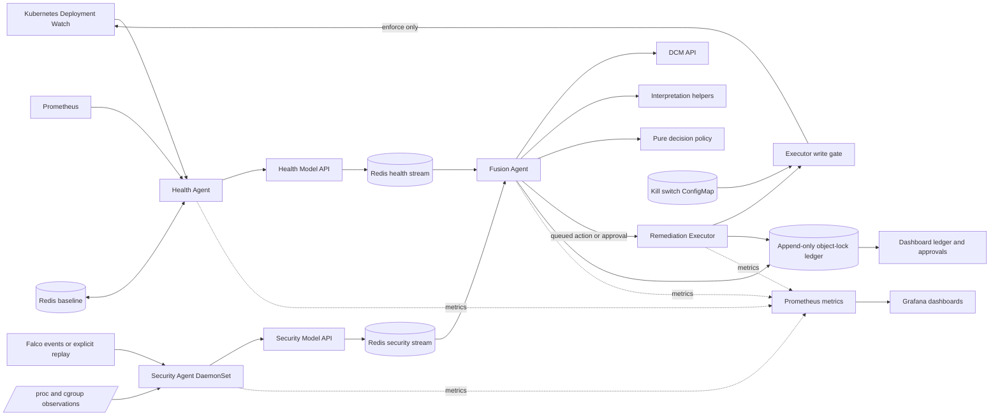

# KubeHeal architecture

The repository implements a five-stage pipeline. This diagram shows the current main path; edges and capabilities marked planned or unverified must not be read as demonstrated behavior.

## Implemented boundaries

- The Health Agent is read-only. It watches Deployments selected by `kubeheal.io/watch=true`, records a first-seen golden spec in Redis if absent, compares current spec to that baseline, and queries a 60-step by 15-metric Prometheus window. Its OBSERVE rescheduler is limited to known drift and an active bounded request from Fusion. The resampling base interval is a chosen default, configurable with `HEALTH_OBSERVE_BASE_S`; it is not a measured profile.
- The Security Agent is deployed as a DaemonSet. It has cgroup process-to-pod mapping, bounded entropy sampling, Falco live/replay/off modes, and read-only Kubernetes access. Replay fixtures are test data, not real captures.
- The Health Model and Security Model are separate scoring services. The DCM is a separate service. They have checkpoint checks and conformal intervals, but their production validity and live-cluster score quality are not established by the repository tests.
- Fusion consumes Redis streams, pairs signals, requests DCM and interpretation outputs, then calls a pure policy. Redis reliability helpers include leases, pending-entry recovery, retries, and dead-letter handling; exact-once processing is not guaranteed by a claim of a single consumer group.
- The Executor is the sole general Kubernetes remediation writer. Its write methods pass through a kill-switch gate. The dashboard has a narrowly scoped exception for changing the mode ConfigMap.
- Audit events are stored through a MinIO-compatible object store with object-lock configuration. Prometheus metrics and Grafana dashboards are present.

## Planned or not fully verified

The full production topology in `PROJECT_SPEC.md` is not yet demonstrated. In particular, scheduled volume snapshots and restore need live validation; the local k3d storage driver has platform constraints. The dashboard is not an authenticated general-purpose operations console. Multi-replica failover semantics, production security, cloud-provider validation, workload-scale behavior, and end-to-end action latency remain unverified. See [SPEC_VS_CODE.md](SPEC_VS_CODE.md) and [docs/dev-notes/PROGRESS.md](../dev-notes/PROGRESS.md).
