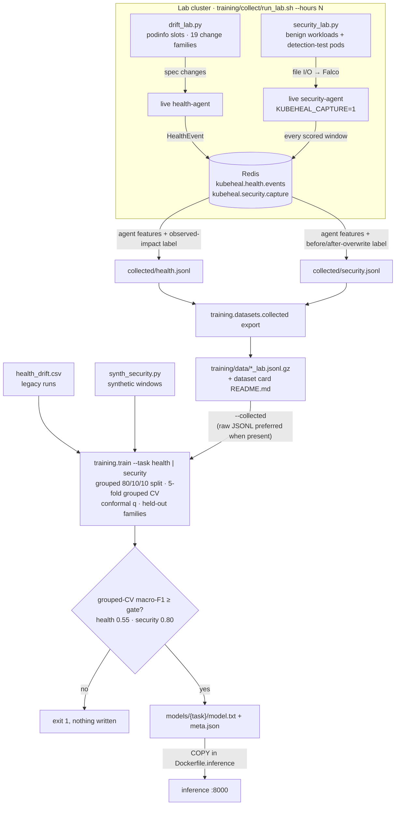

# Models and data

KubeHeal runs two LightGBM classifiers behind one inference service: **health**, which scores a
Deployment spec change together with its post-change metrics, and **security**, which scores one
pod's syscall and entropy window. This document covers their features, the model bundle, training,
the datasets, and how to retrain.

## The parity-by-construction rule

A model is only as good as the match between the inputs it was trained on and the inputs it gets
at serve time. KubeHeal enforces that match structurally, so it does not depend on review:

- **One feature module.** All feature code lives in `kubeheal/features/`. Training, the lab collectors and the live agents import the same functions. There is no second implementation anywhere.
- **Collectors record what the agents computed.** The lab collectors never compute features: health rows carry the features of the `HealthEvent` the live agent published, and security rows carry the features the live agent captured. `train.py --collected` fails if a recorded feature set differs from the current feature list.
- **One metric window.** The health agent and `training/collect/drift_lab.py` both call `agents/health_agent/prometheus.fetch_window` over `[change seen, assess time]` (`ASSESS_DELAY_S` = 60 s by default, shorter when the agent assesses early; `drift_lab.py` records `assess_delay_s`) at `METRIC_STEP_S` = 15 s, which is also Prometheus' scrape interval.
- **Synthetic windows match what Falco can see.** The synthetic security windows are cut down to the agent's view: `CAPTURED_GROUPS` syscalls on the data volume only, at most 512 events, at most `MAX_ENTROPY_SAMPLES` = 8 entropy samples of the first 16 KiB, and the same `window_seconds()` = max(event span, 5 s) capped at 60 s for every per-second rate, defined once in `kubeheal/features/security.py`. A test keeps the Falco rule and `CAPTURED_GROUPS` in sync.
- **Unknown is `None`, never 0.** LightGBM handles missing values natively, and the inference API rejects unknown feature names with a 422.

## Training and data pipeline



## Features

### Health: 36 features (`kubeheal/features/health.py`)

**Raw metrics**, in raw SI units, one PromQL each (`agents/health_agent/prometheus.build_queries`):
`cpu_usage_cores`, `cpu_limit_cores`, `cpu_throttled_ratio`, `memory_working_set_bytes`,
`memory_limit_bytes`, `request_rate_rps`, `error_rate_rps`, `latency_p99_s`, `restarts_total`,
`replicas_desired`, `replicas_ready`.

**24 spec-diff features** are computed on canonical camelCase DeploymentSpecs and summed over containers:

| Group | Features |
|---|---|
| Resources | `cpu_limit_ratio`, `cpu_request_ratio`, `mem_limit_ratio`, `mem_request_ratio` (new/old, `None` if either side is missing), `cpu_limit_removed`, `mem_limit_removed` |
| Scale | `replicas_ratio`, `replicas_to_zero` |
| Image | `image_changed`, `image_unpinned` (no tag, or `:latest`) |
| Security posture | `privileged_added`, `root_user_added`, `capabilities_added`, `host_namespace_added`, `host_path_added` |
| Probes, env, command | `probe_changed`, `probe_removed`, `env_count_delta`, `env_values_changed`, `volume_mounts_removed`, `containers_delta`, `command_changed` |
| Size | `n_changed_fields`, `spec_changed` |

**12 metric features** are computed from the window:

| Features | Definition |
|---|---|
| `cpu_util_mean`, `cpu_util_max` | Usage / limit |
| `cpu_throttle_mean` | Mean throttled ratio |
| `mem_util_mean`, `mem_util_max` | Working set / limit |
| `latency_p99_mean_s`, `latency_p99_max_s` | Mean and max p99 latency |
| `latency_trend` | Slope of p99 latency per minute |
| `error_ratio` | Σ 5xx / Σ requests |
| `request_rate_log` | log1p of the mean request rate |
| `restarts_delta` | Last minus first restart count |
| `ready_ratio` | Last ready / desired |

`failure_reasons` (container waiting reasons and `OOMKilled` in pods created after the change, plus
`ProgressDeadlineExceeded`) is **not** a model feature, so the model's inputs stay identical to the
collected training data. It travels on the `HealthEvent` and drives fusion's rule-based rollback
(see [architecture.md](architecture.md#decision-policy-agentsfusion_agentdecision_policypy)). The model
is left to judge subtle drift such as throttling, latency and memory pressure.

### Security: 26 features (`kubeheal/features/security.py`)

The input is a list of Falco events (`syscall`, `path`, `new_path`, `ts_ms`), the entropy samples of
files the pod wrote, the window length, and two byte counters.

| Group | Features |
|---|---|
| Volume | `n_events`, `events_per_s` |
| Syscall mix | `frac_read` and `frac_write` (per-file opens by intent, via `open_syscall`: the live capture has no `read()`/`write()`), `frac_open` (always 0 live), `frac_rename`, `frac_unlink`, `frac_truncate`, `frac_network`, `frac_mmap`, `frac_exec`, `frac_chmod`. Network, mmap and exec are never captured live, so these are always 0 at serve time. |
| Paths | `unique_paths`, `unique_dirs`, `files_written_per_s`, `rename_ext_change_ratio`, `suspicious_ext_ratio` (27 known ransomware extensions), `ransom_note` (a name like `README_DECRYPT.txt`) |
| Entropy (bits/byte, first 16 KiB) | `entropy_mean`, `entropy_max`, `entropy_p90`, `entropy_high_frac` (> 7.5), `entropy_slope`, `n_entropy_samples`. All `None` when no samples. |
| Byte counters | `write_bytes_per_s` (pod cgroup v2 `io.stat` `wbytes`, counted at writeback), `net_out_bytes_per_s` (TX bytes of every non-loopback interface in the pod netns, `/proc/{pid}/net/dev`). Both are the counter increase across the window divided by its length, and `None` on a pod's first evaluation or after a reset. |
| Short horizon (last `RECENT_EVENTS` = 64 events, so a burst stands out from the setup phase) | `recent_frac_write` (open for write + truncate), `recent_frac_rename`, `recent_frac_unlink`, `recent_frac_chmod` (fractions of the 64), `recent_unique_files` (distinct paths), `recent_ext_change_frac` (renames that change the extension; `None` without renames), `recent_entropy_mean` / `recent_entropy_high_frac` (entropy samples of the files written in those 64 events; `None` without samples), `recent_events_per_s` (64 / max(span, 0.5 s)). Computed by `recent_features()` for the agent and the generator alike; an older bundle without them, or one that leaves some out (the shipped bundle omits `recent_frac_rename`), keeps serving because the inference service ignores `recent_*` it does not list. |

The two byte counters are filled at serve time. They are the agent's only network signal, because
the Falco rule captures file syscalls only. The synthetic generator produces them too: they are
`None` on a first evaluation and in 10 % of windows, as live, and include background traffic.

## The model bundle (`kubeheal/ml/`)

A bundle is a directory with `model.txt` (the LightGBM booster) and `meta.json`, which holds `task`,
`version`, `labels`, `class_risk`, `features`, `alpha`, `conformal_q`, `metrics` (the full training
report), `data` (`source`, `rows`, `groups`, `synthetic`, `sha256`, plus `class_source` for security),
and `created_at`. `ModelBundle.load` refuses a `model.txt` whose feature names or class count do not
match `meta.json`.

`ModelBundle.predict(features)` returns a `Prediction` and works as follows:

- **Inputs:** unknown keys raise an error, missing or non-finite values become NaN, and prediction runs with `num_threads=1`.
- **Label:** the argmax class.
- **Risk:** `risk = Σ p(class) · class_risk`, clipped to [0, 1]. Health class risks are 0.05, 0.60 and 0.95. Security class risks are 0.05, 0.45, 0.95 and 0.85.
- **Conformal set:** `{c : 1 − p_c ≤ max(q, 0.05)}` (the floor admits any label with p ≥ 0.95). `uncertain = len(set) != 1`, so an empty set is uncertain.
- **Top factors:** the 5 largest non-zero |TreeSHAP| contributions to the predicted class, from LightGBM `pred_contrib=True`. These are exact for trees, and the `shap` package is not needed.

### Split-conformal uncertainty (`kubeheal/ml/conformal.py`)

The non-conformity score is `1 − p(true class)`. The threshold `q` is the ⌈(n+1)(1−α)⌉-th smallest
calibration score. If there are too few points for that rank, q = 1 and every label is in the set.
With α = 0.1, the set contains the true label at least 90 % of the time, provided the serve-time data
is exchangeable with the calibration data. Fusion uses the set as a gate: a model-driven AUTO_* action
requires a single-label set.

## Training (`training/train.py`)

```bash
uv run --all-extras python -m training.train --task health                        # legacy CSV
uv run --all-extras python -m training.train --task security                      # synthetic windows
uv run --all-extras python -m training.train --task health --collected            # lab data (+ --with-legacy for the CSV too)
uv run --all-extras python -m training.train --task security --collected --drop-features recent_frac_rename   # shipped bundle: lab data + synthetic suspicious/exfiltration/hard negatives
```

| Flag | Default | Meaning |
|---|---|---|
| `--task` | required | `health` or `security` |
| `--collected` | off | Train on lab data. Security adds synthetic rows only for `suspicious` and `exfiltration`. |
| `--with-legacy` | off | Health with `--collected`: also add the legacy CSV given by `--data` |
| `--data` | `training/data/health_drift.csv` | Legacy health CSV |
| `--n-scenarios` | `3000` | Number of synthetic security scenario instances |
| `--drop-features` | none | Comma-separated features left out of the bundle (the agents still compute them; inference ignores unknown `recent_*`). The shipped security bundle uses `--drop-features recent_frac_rename`. |
| `--alpha` | `0.1` | Conformal miscoverage |
| `--min-macro-f1` | health 0.55, security 0.80 | Promotion gate |
| `--seed` | `7` | Seed for splits, LightGBM and the generator |
| `--out` | `models/<task>` | Bundle directory |

### Procedure

1. **Grouped split.** Data is split 80/10/10 into train, validation and test **by group** (a scenario run, a lab base spec, a pod, or a synthetic scenario instance), stratified on each group's most severe label. No run lands on two sides of the split.
2. **Final model.** The LightGBM multiclass model uses `num_leaves=15`, `learning_rate=0.05`, `min_data_in_leaf=20`, feature and bagging fraction 0.8, `lambda_l2=1` and class-balanced weights. It stops early on the validation set (patience 50, up to 2000 rounds).
3. **5-fold grouped cross-validation** over all non-test groups at the chosen round count. The out-of-fold probabilities feed both the CV report and the conformal calibration. For health, only rows with a real spec change are used, because those are the only inputs the agent ever sends.
4. **Held-out families.** With `--collected`, each lab scenario family is held out in turn and the model never sees it in training. The report gives per-family accuracy and pooled metrics. Detection-test runs are split by variant: rename or in-place, and full or partial overwrite.
5. **Report.** The report contains per-class precision, recall and F1, macro and weighted F1, the confusion matrix, empirical coverage and mean set size for CV and test (health also on spec-changed rows), and single-row latency p50 and p99 including TreeSHAP.
6. **Gate.** The bundle is written only if grouped-CV macro-F1 (for health, on spec-changed rows) is at least the gate. Otherwise the script exits 1 and writes nothing.

## Datasets

| Dataset | Path | Used for | Notes |
|---|---|---|---|
| Legacy drift CSV | `training/data/health_drift.csv` | health (default, or `--with-legacy`) | Real metric samples of earlier drift-lab runs. Group = `collection_run_id` (48 runs, only about 9 with a harmful label). |
| Health lab data | `training/data/collected/health.jsonl` (raw, git-ignored), exported to `training/data/health_lab.jsonl.gz` | health `--collected` | Features from the live health agent, labelled by observed impact |
| Security lab data | `training/data/collected/security.jsonl` (raw), exported to `training/data/security_lab.jsonl.gz` | security `--collected` | Captured windows of benign workloads and the detection-test workload. Captures from before the byte counters existed (`collected/pre-telemetry/`) are never used. |
| Synthetic security | generated by `training/synth_security.py` | security (default), and `suspicious`/`exfiltration` with `--collected` | Hard positives and hard negatives, cut to the agent's view. `meta.json` marks it `synthetic`. With `--collected` it also supplies the benign hard-negative families `atomic_rename` (temp file + rename, editor saves), `logrotate_gz`, `dpkg_install` and `git_npm`, at 20 to 400 files/s with setup phases; `meta.json` reports `synthetic_fraction_by_class`. |

`training/data/README.md` is the dataset card, generated by the export command with row counts, label
counts, scenario families and label reasons. Do not edit it by hand.

### Legacy CSV cleaning (`training/datasets/health.py`)

- **Label mapping:** `Benign_Or_Subtle` → benign, `Harmful_Performance_Degradation` → degradation, any other `Harmful_*` → critical.
- **Pre-drift rows:** `phase == "pre"` rows become benign, because the drift was not applied yet.
- **Dropped rows:** 506 `Synthetic*` augmentation rows, and post-drift rows whose recorded spec did not change.
- **Windows:** each window starts at the change, like the agent's.
- **Units:** `cpu_limit` and `cpu_usage_cores` are in cores, `memory_limit` in MiB, `latency_p99` in seconds.

### Lab collection (`training/collect/`)

`run_lab.sh --hours N` runs both collectors against a lab cluster. It never targets production.
Operational details are in [operations.md](operations.md#lab-data-collection).

**Health** (`drift_lab.py`) runs podinfo "slots" in the namespace `kubeheal-lab`. The namespace is
prod tier (the label is reconciled on every start); the lab Deployments and pods, not the namespace, carry
`kubeheal.io/protected=true`, so fusion never acts on a sample mid-measurement.
Each slot runs a load generator on a random base spec, and the collector applies changes from 21
weighted families with random magnitudes (`FAMILIES` = generators, `WEIGHTS` = the mix, one table in
`drift_lab.py`):

- CPU and memory limits, up and down (ratio-based cuts)
- `cpu_throttle`: an absolute 5–22m CPU limit, and `mem_pressure`: an absolute 30–34 Mi memory limit
  (podinfo's working set is ~21–30 Mi). These target subtle slowdowns: the first lab run produced only
  ~5% degradation, nearly all from CPU limits under ~20m or `--stress-cpu`. Expected non-revert mix
  with the current weights: ~52% benign / ~22% degradation / ~26% critical.
- CPU requests
- replicas: up, down, to zero
- a valid image or a missing image
- probes: break, tweak, remove
- env, args (break or stress), volume-mount removal
- metadata-only changes
- security-posture changes

The label comes from the **observed** impact, never from the scenario name:

| Label | Observed impact |
|---|---|
| `critical` | A posture change (policy), scaled to zero, ready ratio < 0.5, rollout not complete, a pod waiting in a failure state, any restart or OOMKill, or 5xx ratio > 5 % |
| `degradation` | p99 latency ≥ 2× the minute before the change (and at least 10 ms more), CPU throttling > 25 %, or memory > 90 % of the limit |
| `benign` | otherwise |

Restores of the base spec are recorded as `revert` rows, labelled the same way.

**Security** (`security_lab.py`) runs short-lived pods. Each runs an ordinary file workload (backups,
log rotation, databases, compiles, copies, atomic writes, and a `backup_upload` that streams an
archive to an in-cluster TCP sink, `lab-sink:9000`), labelled `benign`, or the
sandboxed `deploy/chaos/detection-test-workload.py`. The detection-test workload creates plain files, waits,
then overwrites them with random bytes and optionally renames them. Windows that end before the
overwrite are `benign`, windows that start after it are `ransomware`, and straddling windows are
dropped. The security agent's capture mode (`KUBEHEAL_CAPTURE=1`) supplies every scored window.

### Synthetic security (`training/synth_security.py`)

The generator has 19 scenario generators across 4 labels:

- **Benign:** web serving, databases, compressed or encrypted backups, media transcoding, log rotation, atomic writes, package installs, backup uploads, maintenance scripts, encrypted-at-rest stores.
- **Suspicious:** reconnaissance, file enumeration, permission tampering.
- **Ransomware:** rename, in-place, copy-then-delete, intermittent or partial, slow.
- **Exfiltration.**

Paths, extensions and window lengths are randomised, and 0 to 80 % background noise is added before
the window is cut to the agent's view. Each scenario instance yields 1 to 4 windows sharing one group.

## Retrain and ship

```bash
training/collect/run_lab.sh --hours 12                        # optional: more lab data
uv run --all-extras python -m training.datasets.collected export           # gz exports + training/data/README.md
uv run --all-extras python -m training.train --task health --collected     # writes models/health/ only if it passes the gate
uv run --all-extras python -m training.train --task security --collected
uv run --all-extras pytest tests/test_bundle.py tests/test_inference_api.py
./deploy/scripts/install.sh                                          # rebuilds kubeheal/inference:v5 with the new bundles
```

The bundles are baked into the inference image (`COPY models/...`). To pick up new bundles, rebuild
the image and roll out `kubeheal-inference`.

## Metrics

Values from `models/{health,security}/meta.json`, plus my own nested evaluation for the security rows marked
"eval" (scripts are not in the repo). Health numbers use real, spec-changed rows only (metric-dropout copies are fit-only).

| | Health | Security |
|---|---|---|
| Bundle version | `health-5.0.0-37c9309f` | `security-5.0.0-ca2438d3` |
| Rows / groups / sources | 2,519 / 237 / lab (`collected/health.jsonl`; 1,223 rows from the 120 s window era) | 40,286 / 1,663 / lab 37,406 (benign + ransomware) + synthetic 2,880 (7.2 %): suspicious and exfiltration (1,511, 100 % of those classes) and benign hard negatives (1,369, 3.9 % of benign); ransomware is 0 % synthetic. `meta.json` has `synthetic_fraction_by_class` |
| Grouped-CV macro-F1 (gate) | 0.922 | 0.9996 |
| Test macro-F1 | 0.939 (n = 240) | 1.000 (n = 3,931) |
| Held-out-family macro-F1 (pooled) | 0.851 (23 families) | 0.999 over benign + ransomware (meta.json: 0.50, because exfiltration and suspicious do not occur in lab families) |
| Per-class F1 (grouped CV) | benign 0.961, critical 0.879, degradation 0.925 | benign 1.000, ransomware 0.9998, suspicious 0.9994, exfiltration 0.9991 |
| Conformal q / coverage / mean set size | 0.386 / 0.900 / 0.93 | 4.4e-6 (serving floors it at 0.05) / 1.000 / 1.00 |
| Latency p50 / p99 (ms) | 1.9 / 2.3 | 10.4 / 12.6 |
| Eval: pod-level ransomware recall, prod tier (5-fold by pod, bundle q) | | 217 / 217 (`a49c7ed8` and the no-recent variants: 217 / 217) |
| Eval: benign pods falsely killed (305 pods; prod and dev) | | 0 / 305 (interim: 0 / 305); dev never kills, its 0.7 multiplier caps risk at 0.7 < 0.85 |
| Eval: first overwrite to first kill-eligible window, median / p90 | | 0.23 s / 0.65 s (interim: 0.27 s / 0.88 s) |
| Eval: health, same grouped held-out groups, 5 seeds | 0.919 +/- 0.014 on all data, 0.914 +/- 0.021 on the 2,030 rows the previous bundle saw | |

Health: against the previous bundle (`health-5.0.0-3a1d9811`, 2,030 rows), the extra 489 rows leave macro-F1 within
noise (0.919 vs 0.914) and raise critical recall (0.957 vs 0.939) at a small cost in degradation recall
(0.882 vs 0.902). The previous bundle scored 0.862 macro-F1 on those 489 rows, which it had not seen.

Security: `recent_*` features carry about 5 % of the gain. They did not change in-distribution results (the interim bundle, which
ignores them, scores the same). What they buy is speed at 180 files/s, and what one of them costs is generalisation, see below.

Hardening against unseen benign write patterns (security). Each variant retrained on the same lab data (variant 1 with the synthetic rows redrawn, so not byte-identical to the shipped `a49c7ed8`) and
evaluated by pod at prod tier (kill rule: kill label, singleton conformal set, `min(1, risk * 1.2) >= 0.85`).
"LOFO" holds one lab family out of training in turn; "latency" is first ransomware window start to first
kill-eligible window end in 5-fold grouped CV by pod. Ransomware recall is 217 / 217 pods in every variant, in
5-fold CV and in LOFO over the four `detection_test` variants.

| Variant | Benign pods killed, LOFO (305 pods; worst family) | 5-fold CV: benign kills / latency median, p90 | Live kill, 180 files/s / 20 files/s | Live benign atomic-write pods |
|---|---|---|---|---|
| 1. `a49c7ed8`: all `recent_*`, no hard negatives | 23 (`atomic_config_writes` 23 / 30) | 0 / 0.23 s, 0.65 s | 0.65 to 0.72 s / 2.1 to 2.3 s | killed (replay of the live windows) |
| 2. no `recent_*`, hard negatives | 1 (`redis_snapshots`) | 0 / 0.23 s, 0.65 s | as 3 (replay) | not killed (replay) |
| 3. all `recent_*`, hard negatives | 0 | 0 / 0.23 s, 0.65 s | 1.15 to 1.27 s / 8.7 to 8.9 s | not killed (replay) |
| 4. `recent_*` minus `recent_frac_rename`, hard negatives: **`ca2438d3`, shipped** | 0 | 0 / 0.23 s, 0.65 s | 1.17 to 1.34 s / 8.7 to 9.0 s | 3 / 3 not killed |
| 5. `recent_*` minus `recent_frac_rename`, no hard negatives: `d1eb7c81` | 0 | 0 / 0.23 s, 0.65 s | 0.64 to 0.81 s / 2.2 to 2.3 s | 3 / 3 killed |

Findings. (a) `recent_frac_rename` is the feature that drives the false kills: dropping it alone takes the
`atomic_config_writes` hold-out from 23 to 0 kills, dropping `recent_ext_change_frac` does not. Dropping more
`recent_*` features is not more robust (one such model killed 13 of 30 again). (b) The lab-only CV and LOFO
numbers do not separate the variants. Live they do: the hard-negative families (`atomic_rename`,
`logrotate_gz`, `dpkg_install`, `git_npm` in `training/synth_security.py`) are what stop the model killing a
live atomic-write workload (variant 5 kills it: its decision rests on `unique_dirs` and `files_written_per_s`
with unknown entropy), but any amount of them (down to 5 % weight, any single family) moves the first
confident window of the back-to-back detection workload later. The lab data has a 65 to 80 s gap between
setup and encryption, so it cannot show this. (c) Hold-out results of models trained without hard negatives
flip with the LightGBM seed or thread count (a 0 / 30 result became 13 / 30), so a clean number there is thin evidence.

## Known limitations

- **Exfiltration rests entirely on synthetic data.** The serve-time byte counters are real measurements, but `exfiltration` and `suspicious` are trained only on synthetic windows. Treat `exfiltration` predictions as unvalidated until real labelled windows exist.
- **Narrow health data.** There is one workload type (podinfo) on a single minikube node. The legacy CSV has only about 9 harmful runs, so health quality depends on lab data.
- **One ransomware simulator.** It is non-destructive and randomised (rate, size, rename, partial overwrite), but it is not real malware.
- **Short window.** Health labels and features cover the first 60 s after a change (the assess delay; shorter on an early assessment). Slow leaks are judged by what was visible within that time.
- **Conformal assumptions.** The coverage guarantee assumes exchangeability. A shift from the lab to production weakens it, and the set size is the signal to watch.
- **Safety was bought with kill speed (security).** The shipped bundle holds out every benign lab family with 0 pod kills, and three live pods that write a temp file and rename it over the target about 80 times a second for 60 s were not touched. The price: the back-to-back detection workload is now killed after a median 1.33 s at 180 files/s (was 0.67 s) and 8.85 s at 20 files/s (was 2.25 s), because the synthetic hard-negative families move the first confident window later. The fast model without them (`d1eb7c81`, kept out of the repo) kills that atomic-write workload. A rename-heavy benign family unlike `atomic_rename`, `logrotate_gz`, `dpkg_install`, `git_npm` and the lab families may still be killed. Fixing both needs feature redefinitions and a new lab collection: separate "rename adds a suffix" (encryption) from "rename removes a temp suffix or replaces an existing file" (atomic write), give `recent_ext_change_frac` the extension relative to the original name, and collect ransomware runs without the 65 to 80 s quiet gap. Kills stay behind the protected namespaces, the `kubeheal.io/protected` label, the circuit breakers and the prod-only 0.85 gate.
- **Back-to-back create-then-encrypt is slower to kill.** The lab data has a quiet gap (65 to 80 s) between setup and encryption. Without a gap, the setup events fill the window and the model waits for the recent-event tail to fill with encryption: 8.85 s median at 20 files/s versus 1.33 s at 180 files/s.
